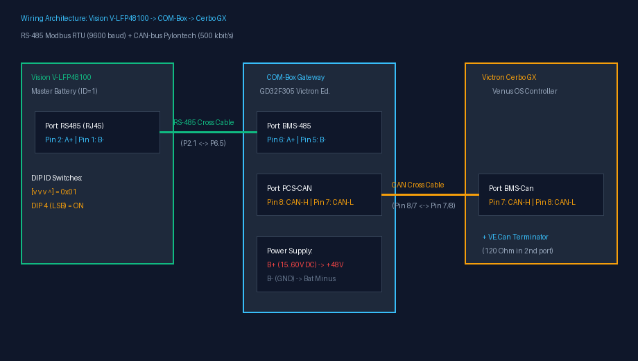
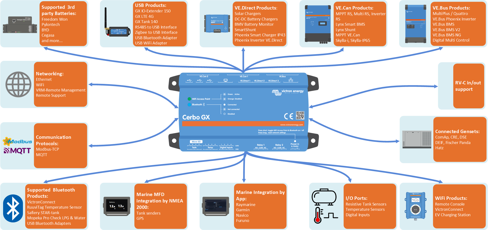
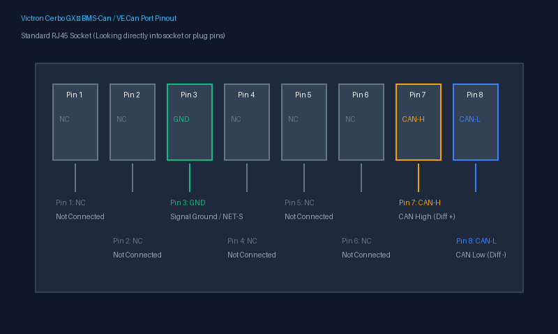
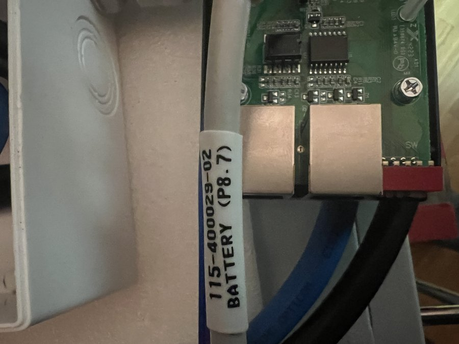
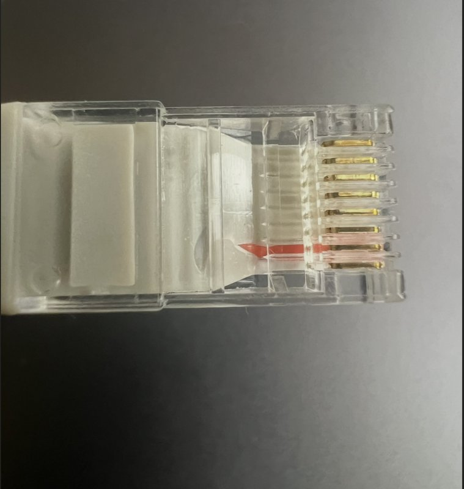
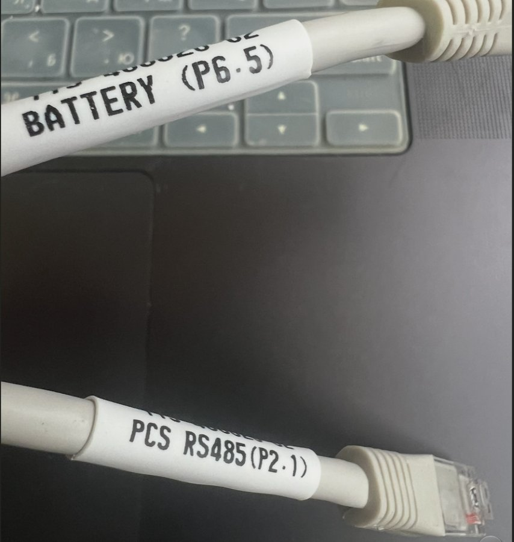
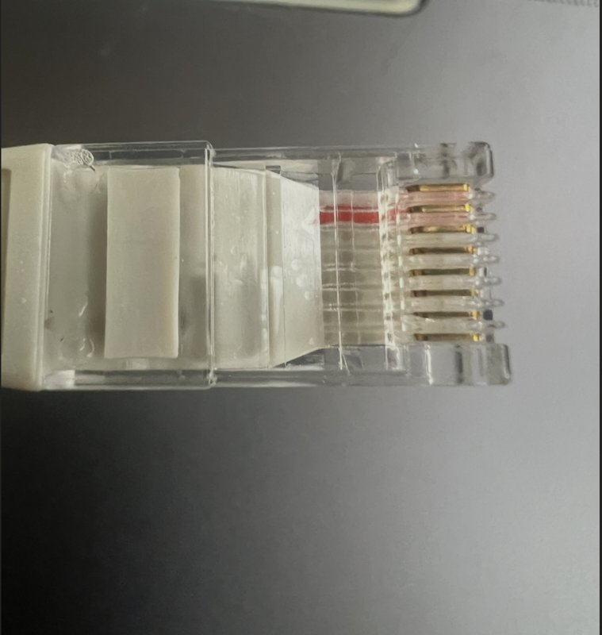
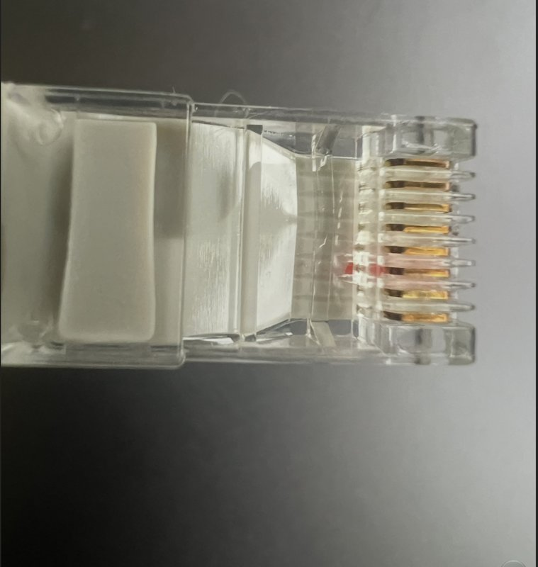
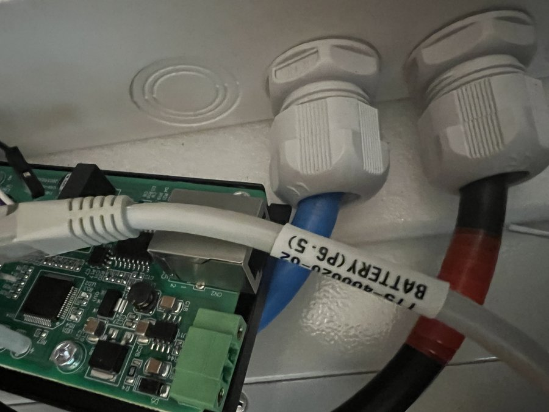
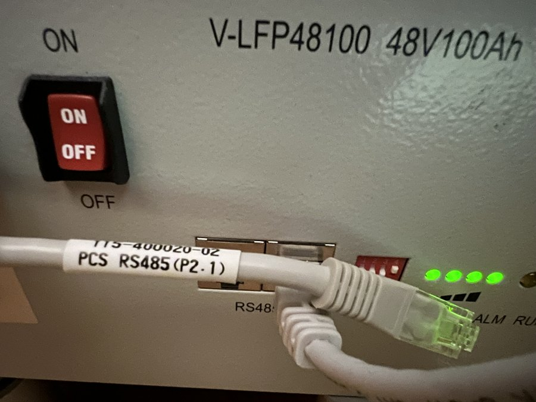

# COM-Box Victron Edition (Cerbo GX & MultiPlus-II)

> [!WARNING]
> ### ВІДМОВА ВІД ВІДПОВІДАЛЬНОСТІ / DISCLAIMER (НЕОФІЦІЙНИЙ ПРОЕКТ)
> **Цей проект є виключно некомерційною аматорською інженерною розробкою (DIY / Proof of Concept).**  
> * Проект **не є** офіційним продуктом, не афілійований, не спонсорується та не схвалений компаніями **Victron Energy**, **Vision Group (Center Power)** або **Felicity Solar**. Всі торговельні марки належать їх законним власникам.
> * Ця розробка є спробою реалізувати сумісність та підключити промислові акумулятори **Vision V-LFP48100** до екосистеми **Victron Energy** за допомогою апаратного шлюзу COM-Box.
> * **Використання виключно на власний розсуд і ризик:** Автори та розробники проекту **не несуть жодної відповідальності** за будь-яке пряме чи непряме пошкодження акумуляторів, інверторів, контролерів, проводки, іншого обладнання, а також за втрату даних, збої в електропостачанні, пожежі або будь-які інші збитки.
> * Робота з силовими акумуляторними батареями 48В та високими струмами становить потенційну небезпеку. Користувач несе повну особисту відповідальність за правильність монтажу, виготовлення кабелів, налаштування систем захисту та дотримання правил електробезпеки.

---

> **Призначення:** Апаратний інтеграційний міст між акумуляторними модулями **Vision V-LFP48100 (15S LiFePO4)** та екосистемою **Victron Energy** (Cerbo GX, Venus OS, MultiPlus-II, Quattro).

---

## 1. Архітектура системи

```
[ АКБ Vision V-LFP48100 (1..16 блоків) ]
              │  Шина RS-485 (Modbus RTU @ 9600, порт BATTERY 485)
              ▼
   ┌──────────────────────┐
   │  COM-Box (GD32F305)  │  ◄── Адаптивна прошивка під Victron Energy
   └──────────────────────┘
              │  Шина CAN (Pylontech v2.0.6 @ 500 кбіт/с, порт PCS-CAN)
              ▼
   ┌──────────────────────┐
   │   Victron Cerbo GX   │  (порт BMS-Can, профіль "CAN-bus BMS 500k")
   └──────────────────────┘
              │  Шина VE.Bus + протокол DVCC
              ▼
   ┌──────────────────────┐
   │  MultiPlus-II / MPPT │  ◄── Автоматичне регулювання струму та напруги
   └──────────────────────┘
```

---

## 2. Адаптація під Victron Cerbo GX (Venus OS)

Ця версія прошивки оптимізована як прозорий інтеграційний міст між батареями Vision та системою Victron Energy:

1. **Паспортні параметри напруги (Vision V-LFP48100 15S):**
   * **Рекомендована напруга заряду CVL:** Запит **54.0 В** (3.60 В/комірку) точно відповідає офіційному паспорту *Vision V-LFP48100 Recommended charging voltage*. Шлюз не нав'язує власних штучних режимів, а передає паспортні дані виробника АКБ. У меню Cerbo GX DVCC напруга за потреби обмежується користувачем (наприклад, до **52.4–52.5 В** для максимально довговічної роботи LiFePO4).
   * **Нижня відсічка розряду DVL:** **42.0 В** (2.80 В/комірку) — паспортний поріг *Discharge cut-off voltage*.
2. **Канонічна полярність струму (CAN ID `0x356`):**
   * **Струм заряду:** Позитивний (`+`) — заряджання відображається коректно у VRM Portal та на GX Touch.
   * **Струм розряду:** Негативний (`-`) — відтік енергії у навантаження будинку.
   * **Перевірка знаку на живому обладнанні:** Після першого підключення увімкніть навантаження (розряд) і перевірте плитку батареї на **GX Touch** / у **VRM Portal** — струм і потужність мають бути з мінусом (`-`), а під час заряду — з плюсом (`+`). Якщо знак інвертований на конкретній BMS, перевірте прапорець `BMS_CURRENT_CHARGE_IS_POSITIVE` у `src/main.cpp` (внутрішня конвенція прошивки: розряд `> 0`, заряд `< 0`, а при пакуванні `0x356` струм інвертується під стандарт Victron).
3. **Чесна передача SOC (CAN ID `0x355`) та захист кількості модулів:**
   * Venus OS отримує реальний адаптивний SOC акумулятора без спотворень.
   * При таймауті опитування BMS лічильник `bms_pack_count` обмежується знизу значенням `1` (ніколи не `0`).
4. **Ідентифікація бренду (CAN ID `0x35E`):**
   * Транслюється маркер `"PYLON"`, що активує перевірений системний драйвер акумулятора у Venus OS без сторонніх патчів.

---

## 3. Схеми кабелів та фото підключення



### 3.1. COM-Box ➔ Victron Cerbo GX (CAN-шина BMS-Can)

> ⚠️ **КРИТИЧНО ВАЖЛИВО:** Прямий комп'ютерний патч-корд RJ45 використовувати **СУВОРО ЗАБОРОНЕНО**!  
> Піни 7 та 8 на платах COM-Box та Cerbo GX мають протилежне призначення. Пряме з'єднання призведе до замикання CAN-H на CAN-L!

| Огляд портів Victron Cerbo GX | Схема розпіновки порту Cerbo GX BMS-Can / VE.Can |
| :---: | :---: |
|  |  |

#### Схема крос-кабелю CAN (згідно з [Victron CAN-bus BMS Cable Guide](https://www.victronenergy.com/live/battery_compatibility:can-bus_bms-cable)):
```
Сторона COM-Box (PCS-CAN)               Сторона Victron Cerbo GX (BMS-Can)
┌───────────────────────┐               ┌────────────────────────┐
│ Pin 8 (CAN-H) ────────┼───────────────┼──► Pin 7 (CAN-H)       │
│ Pin 7 (CAN-L) ────────┼───────────────┼──► Pin 8 (CAN-L)       │
│ Pin 1 (GND)   ────────┼───────────────┼──► Pin 3 (GND / NET-C) │
│ (решта не підключені) │               │ (решта не підключені)  │
└───────────────────────┘               └────────────────────────┘
```

| Підключення роз'єму PCS-CAN на COM-Box | Штекер кабелю `(P8.7)` |
| :---: | :---: |
|  |  |
| **Порт `PCS-CAN` (Pin 8=CAN-H, Pin 7=CAN-L)** | **Розшито піни 8 та 7 з боку коробки** |

* Усі інші піни (1, 2, 4, 5, 6 з боку Cerbo GX) повинні залишатися **порожніми** (обрізаними).
* У сусіднє вільне гніздо BMS-Can на Cerbo GX **обов'язково встановіть синій термінатор 120 Ом (VE.Can Terminator)**, що входить у комплект Cerbo GX.

---

### 3.2. COM-Box ➔ Vision V-LFP48100 (RS-485 опитування батареї)

> ⚠️ **Прямий патч-корд не підходить!**  
> У COM-Box лінії RS485 виведені на Pin 5 (B) та Pin 6 (A), а в батареї Vision — на Pin 1 (B) та Pin 2 (A).

#### Схема адаптерного кабелю RS-485:
```
Сторона COM-Box (BMS-485)               Сторона Vision BMS (RS485)
┌───────────────────────┐               ┌────────────────────────┐
│ Pin 6 (BMS-485A) ─────┼───────────────┼──► Pin 2 (RS485-A)     │
│ Pin 5 (BMS-485B) ─────┼───────────────┼──► Pin 1 (RS485-B)     │
│ Pin 1 (GND)      ─────┼───────────────┼──► Pin 3 або 6 (GND)   │
│ (решта не підключені) │               │ (решта не підключені)  │
└───────────────────────┘               └────────────────────────┘
```

#### Фото заводського кабелю та підключення:

| Маркування кабелю | Штекер COM-Box `(P6.5)` | Штекер батареї Vision `(P2.1)` |
| :---: | :---: | :---: |
|  |  |  |
| **Бірка `P6.5` ↔ `P2.1`** | **Розшито піни 6 та 5** | **Розшито піни 2 та 1** |

| Підключення до порту COM-Box `BMS-485` | Підключення до порту батареї Vision `RS485` |
| :---: | :---: |
|  |  |
| ➡️ **Порт `BMS-485` на коробці** | ➡️ **Порт `RS485` на головній АКБ** |

* **Міжблочний ланцюг АКБ:** Між собою блоки Vision з'єднуються **звичайним прямим патч-кордом RJ45** із сусіднього вільного роз'єму `RS485` попередньої батареї у роз'єм `RS485` наступної (Daisy Chain).

---

## 4. Налаштування в Cerbo GX (Venus OS)

1. **Профіль порту CAN:**
   * Меню: `Settings` ➔ `Services` ➔ `VE.Can port` (або `BMS-Can port`) ➔ `CAN-bus profile`.
   * Встановити: **`CAN-bus BMS (500 kbit/s)`**.
2. **Налаштування DVCC:**
   * Меню: `Settings` ➔ `DVCC`.
   * **DVCC:** `ON` (Увімкнено).
   * **Limit managed battery charge voltage:** `ON` ➔ встановити значення **`52.4 V`** або **`52.5 V`** (рекомендація Victron для 15S).
   * **Shared Voltage Sense (SVS):** `OFF` (для CAN-BMS функція SVS має бути вимкнена).
   * **Controlling BMS:** Вибрати підключену батарею Pylontech.

---

## 5. Конфігурація DIP-перемикачів COM-Box

| Перемикач | Функція | Стан OFF (Вниз, типово) | Стан ON (Вгору) |
|---|---|---|---|
| **DIP1 (SW1)** | Резерв | Зарезервовано (відключено) | Зарезервовано (відключено) |
| **DIP2 (SW2)** | **Режим порту PCS-485** | **Дзеркало BMS телеметрії** (для ПК / `bms_web.py`) | Наскрізний міст |
| **DIP3 (SW3)** | **Режим опитування RS-485** | **Plug & Play автопошук** (швидкий цикл 400–800 мс) | Примусове повне сканування (всі 16 адрес, 6.4 с) |
| **DIP4 (SW4)** | Резерв | Зарезервовано (відключено, струм 50 А за паспортом) | Зарезервовано (відключено, струм 50 А за паспортом) |
| **DIP5 (SW5)** | Резерв | Зарезервовано (відключено) | Зарезервовано (відключено) |

---

## 6. Збірка, розробка та модифікація (PlatformIO)

Проект створено та налаштовано для роботи в середовищі **PlatformIO** (вбудованому у **VS Code** або через консольну утиліту `pio` Core). Ви можете легко адаптувати, модифікувати та доопрацьовувати логіку під власні потреби.

### 6.1. Структура коду та ключові файли для модифікації:
* **[`src/main.cpp`](src/main.cpp):** Основний монолітний код шлюзу. Тут зосереджена вся логіка:
  * `bms_poll_step()` — опитування регістрів Modbus RTU акумуляторів Vision. Якщо у вас інші акумулятори або інший протокол RS-485, зміни вносяться тут.
  * `calculate_charge_limit()` — алгоритм визначення струму заряду (CCL) та напруги (CVL) на основі стану найслабшої/найсильнішої комірки (Vmax, Vmin, температура).
  * `send_all_frames()` — формування та надсилання CAN-кадрів стандарту Pylontech v2.0.6 (`0x359`, `0x351`, `0x355`, `0x356`, `0x35C`, `0x35E`) до Cerbo GX.
  * `dip_charge_profile_apply()` — обробка положень перемикачів SW1–SW5.
* **[`platformio.ini`](platformio.ini):** Конфігурація компілятора та плати. Для мікроконтролера **GigaDevice GD32F305RCT6** використовується базова модель `genericSTM32F103RC` з фірмовим лінкер-скриптом [`GD32F305RC_COMBOX.ld`](GD32F305RC_COMBOX.ld) (розширено оперативну пам'ять до 96 КБ RAM).
* **[`tools/export_manual_pdf.py`](tools/export_manual_pdf.py):** Скрипт автоматичної збірки PDF-інструкції користувача (`USER_MANUAL.pdf`) з Markdown через headless Chrome.
* **[`tools/bms_web.py`](tools/bms_web.py):** Локальний веб-сервер для діагностики й перегляду стану всіх комірок наживо.

### 6.2. Як зібрати проект:
1. Встановіть **VS Code** та розширення **PlatformIO IDE** (або встановіть CLI: `pip install platformio`).
2. Відкрийте папку проекту `COMBOX_VICTRON` у VS Code.
3. Для компіляції прошивки виконайте команду в терміналі:
   ```bash
   pio run
   ```
   Скомпільовані бінарники будуть збережені в каталозі:
   * `.pio/build/genericGD32F305/firmware.bin` (та `.hex`)
   * А також у релізній папці: `compiled_firmware/firmware.bin`

### 6.3. Як прошити мікроконтролер GD32F305:
* **Через ST-Link V2 (SWD):**
  На платі COM-Box розведено стандартний роз'єм SWD (SWDIO, SWCLK, GND, 3.3V).
  ```bash
  pio run -t upload
  ```
  *(Або скористайтеся утилітою STM32CubeProgrammer / OpenOCD / pyOCD, вибравши файл `compiled_firmware/firmware.bin` за початковою адресою `0x08000000`)*.

---

## 7. Моніторинг

Для діагностики шини RS-485 та перевірки стану всіх комірок Vision можна використовувати веб-інтерфейс:

```bash
python3 tools/bms_web.py --port /dev/tty.usbserial-XXXX
```
Відкрити у браузері: `http://localhost:8080`.

