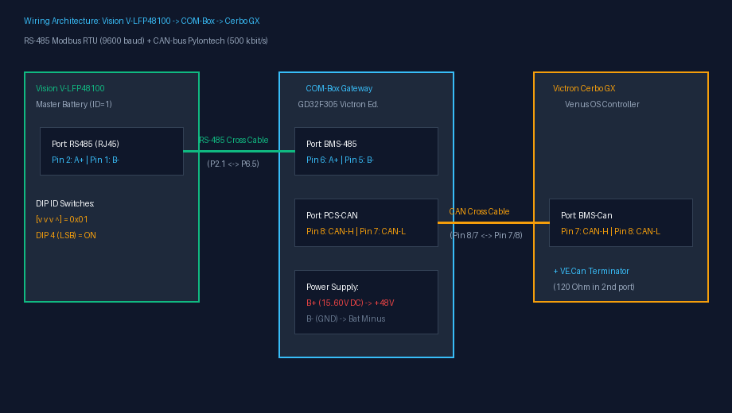
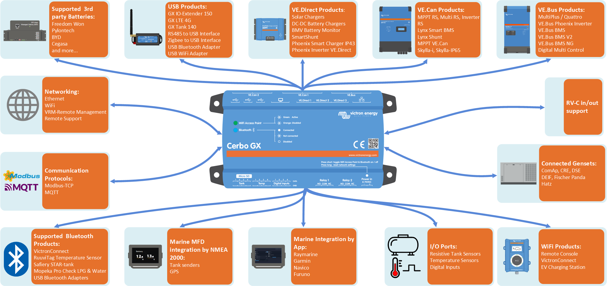
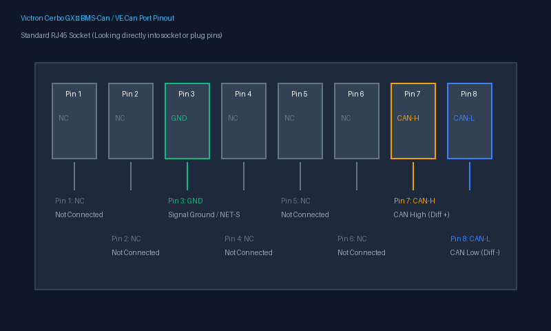
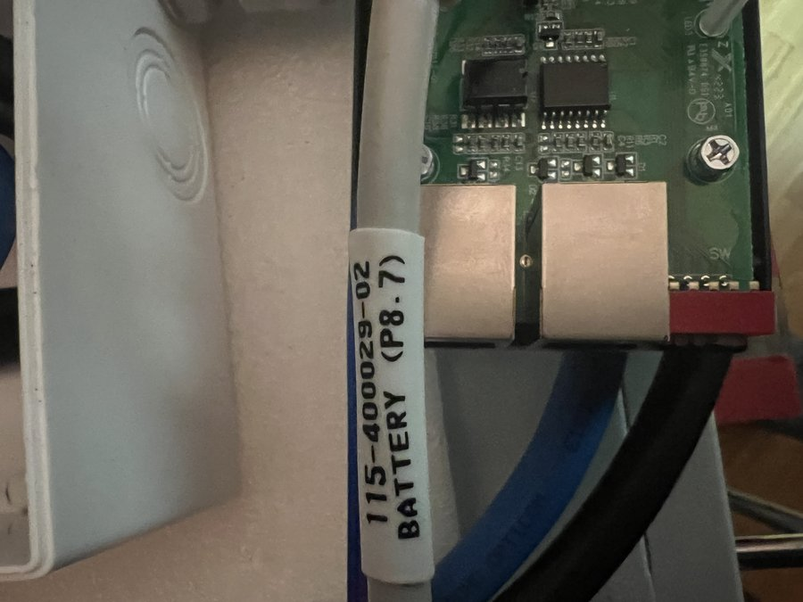
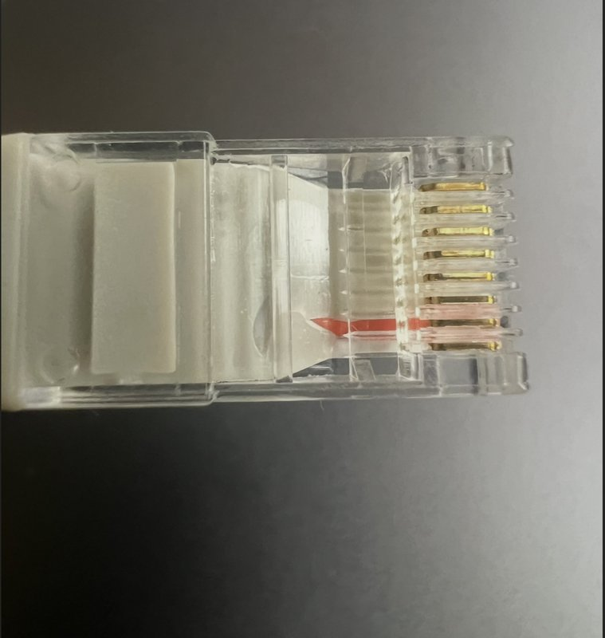
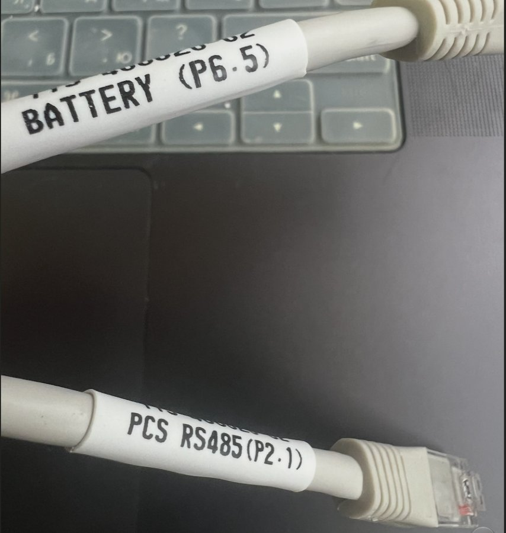
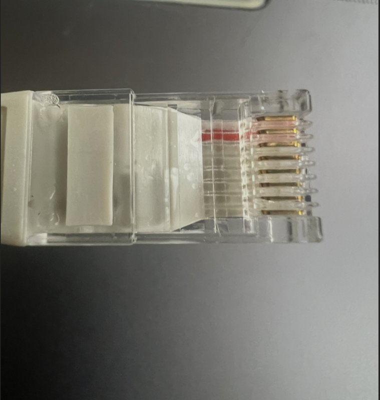
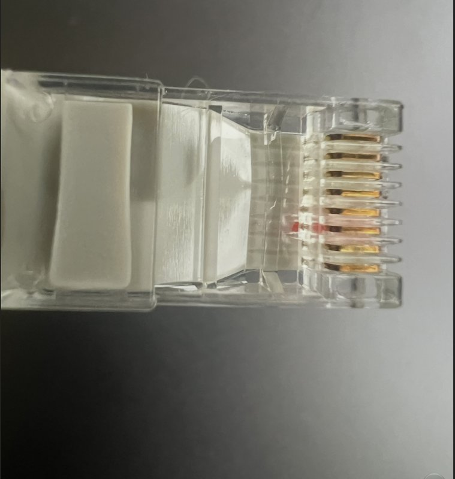
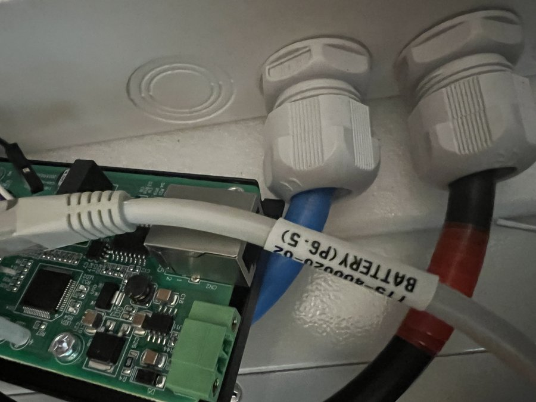
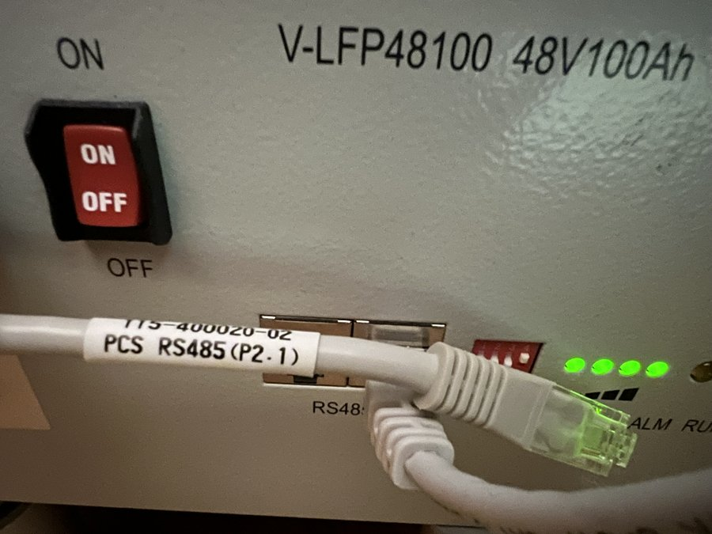

# Інструкція користувача: COM-Box Victron Edition
### Апаратний міст між акумуляторами Vision V-LFP48100 (15S LiFePO4) та екосистемою Victron Energy (Cerbo GX / MultiPlus-II)

> [!WARNING]
> ### ВІДМОВА ВІД ВІДПОВІДАЛЬНОСТІ / DISCLAIMER
> **Цей проект є некомерційною інженерною ентузіастською розробкою (DIY / Open Source).**  
> Проект не є офіційним продуктом і не має відношення до компаній Victron Energy, Vision Group або Felicity Solar. Це інженерна спроба інтегрувати батареї Vision V-LFP48100 у середовище Victron Energy.  
> Використання даної схеми, прошивки та інструкцій здійснюється **виключно на власний розсуд та під особисту відповідальність користувача**. Розробники не несуть відповідальності за пошкодження обладнання, вихід з ладу елементів живлення, інверторів чи будь-які інші збитки. Дотримуйтесь правил техніки безпеки при роботі з постійним струмом та акумуляторами високої ємності.

---

## 1. Призначення пристрою

**COM-Box Victron Edition** — це спеціалізований мікроконтролерний шлюз на базі процесора **GD32F305**, розроблений для повної безшовної інтеграції промислових літій-залізо-фосфатних акумуляторів **Vision V-LFP48100 (15S 48V 100Ah)** в енергетичні системи **Victron Energy**.

Пристрій виконує дві ключові ролі:
1. **Збір телеметрії (RS-485 Modbus RTU):** Безперервно опитує від 1 до 16 акумуляторних блоків Vision, збираючи точні напруги кожної комірки (15S), струми, температури, лічильники ємності, аварійні статуси та стан вбудованих балансирів.
2. **Керування системою Victron (CAN Bus @ 500 кбіт/с):** Транслює агреговані параметри банку в системний контролер **Victron Cerbo GX** через стандартний протокол **Pylontech CAN v2.0.6**. Контролер Cerbo GX автоматично керує інвертором **MultiPlus-II / Quattro** через механізм **DVCC** (Distributed Voltage and Current Control).

---

## 2. Апаратні роз'єми, індикація та живлення COM-Box

### 2.1. Роз'єми на корпусі пристрою:
* **`BMS-485` (RJ45):** Підключення до шини зв'язку акумуляторів Vision (порт `RS485` на провідному блоці АКБ).
* **`PCS-CAN` (RJ45):** Підключення до порту **BMS-Can** контролера Victron Cerbo GX.
* **`PCS-485` (RJ45):** Діагностичний порт зв'язку з ПК (моніторинг `bms_web.py`).
* **`SW` (Блок із 5 DIP-перемикачів):** Апаратне налаштування профілів заряду, режимів сканування та балансування.
* **Клеми живлення `B+` та `B-`:** Підключення безпосередньо до шини акумуляторного банку (робочий діапазон **від 15 В до 60 В DC**).
  * **`B+`** — підключається до клеми `+48 В` акумулятора.
  * **`B-`** — підключається до клеми `GND` / `-` акумулятора.

### 2.2. Світлодіодна індикація на кришці COM-Box (LED3..LED6):
На верхній кришці розташовані 4 світлодіоди з шовкографією Felicity:
```
┌────────────────────────────────────────────────────────┐
│                     ВЕРХНЯ КРИШКА                      │
│                                                        │
│     ( 1 )        ( 2 )           ( 3 )       ( 4 )     │
│    PCS-485      PCS-CAN         BMS-485     Running    │
│    Connect      Connect         Connect                │
└────────────────────────────────────────────────────────┘
```

| Індикатор на кришці | Пін MCU | Поведінка | Опис та стан системи |
|---|:---:|---|---|
| **1. PCS-485 Connect** | `PC4` | Спалахує під час обміну | Активність на порту `PCS-485` (підключено ПК або веб-діагностику `bms_web.py`). |
| **2. PCS-CAN Connect** | `PC5` | Спалахи з частотою **1 Гц** | **Активна трансляція CAN-телеметрії у Cerbo GX** (пакети 0x351, 0x355, 0x356 тощо). |
| **3. BMS-485 Connect** | `PB1` | Короткі ритмічні спалахи | **Активний обмін з акумуляторами Vision** по RS-485 (кожен спалах — запит/відповідь блоку). |
| **4. Running** | `PB0` | **Світиться постійно** | Ядро GD32 запущене, операційна система та алгоритми працюють стабільно. |

*(Додатково на платі: **LED1 (PC13)** блимає з частотою 1 Гц, коли активна сесія вирівнювання/балансування; **LED2** світиться постійно — живлення 3.3 В).*

---

## 3. Схеми кабелів підключення



> ⚠️ **КРИТИЧНЕ ПОПЕРЕДЖЕННЯ З БЕЗПЕКИ:**  
> **НІКОЛИ НЕ ВИКОРИСТОВУЙТЕ ЗВИЧАЙНИЙ ПРЯМИЙ ПАТЧ-КОРД ДЛЯ З'ЄДНАННЯ З CERBO GX!**  
> У гнізді COM-Box `PCS-CAN` лінія CAN-H розведена на Pin 8, а у Victron Cerbo GX на Pin 8 знаходиться лінія CAN-L. Якщо вставити прямий кабель, диференційні лінії CAN-H та CAN-L замкнуться між собою, зв'язок не запуститься, а трансивер може вийти з ладу!

### 3.1. Спеціальний кабель CAN: COM-Box ➔ Victron Cerbo GX

| Огляд комунікаційних портів Cerbo GX | Схема розпіновки порту BMS-Can / VE.Can |
| :---: | :---: |
|  |  |

Для підключення виготовляється або обтискається трижильний крос-кабель крученої пари (UTP Cat5e/Cat6) згідно з офіційним стандартом [Victron CAN-bus BMS Cable Guide](https://www.victronenergy.com/live/battery_compatibility:can-bus_bms-cable):

```
Сторона COM-Box (Порт PCS-CAN)          Сторона Victron Cerbo GX (Порт BMS-Can)
┌──────────────────────────────┐        ┌──────────────────────────────────────┐
│ Pin 8 (CAN-H) ───────────────┼────────┼──► Pin 7 (CAN-H)                     │
│ Pin 7 (CAN-L) ───────────────┼────────┼──► Pin 8 (CAN-L)                     │
│ Pin 1 (GND)   ───────────────┼────────┼──► Pin 3 (GND / NET-C)               │
│                              │        │                                      │
│ Піни 2, 3, 4, 5, 6 НЕ ПІДКЛ. │        │ Піни 1, 2, 4, 5, 6 НЕ ПІДКЛЮЧАТИ!   │
└──────────────────────────────┘        └──────────────────────────────────────┘
```

| Роз'єм PCS-CAN на коробці COM-Box | Штекер кабелю `(P8.7)` |
| :---: | :---: |
|  |  |
| **Порт `PCS-CAN` (Pin 8=CAN-H, Pin 7=CAN-L)** | **Розшито піни 8 та 7 з боку коробки** |

> **Обов'язковий термінатор 120 Ом:**  
> Шина CAN вимагає узгодження на обох кінцях лінії.  
> У сусіднє вільне гніздо порту BMS-Can на Cerbo GX **обов'язково вставте синій фірмовий термінатор 120 Ом (VE.Can Terminator)**, що входить у комплект Cerbo GX.

### 3.2. Кабель RS-485: COM-Box (BMS-485) ➔ Vision V-LFP48100 (RS485)
> ⚠️ **УВАГА: Прямий патч-корд НЕ ПІДХОДИТЬ!**  
> Згідно з офіційною специфікацією Felicity Solar COM-BOX, лінії опитування акумулятора виведені на **Pin 5 (BMS-485B)** та **Pin 6 (BMS-485A)**, тоді як у батареях Vision V-LFP48100 лінії даних знаходяться на **Pin 1 (RS485-B)** та **Pin 2 (RS485-A)**.

Для з'єднання використовується адаптерний 3-жильний кабель:

```
Сторона COM-Box (Порт BMS-485)          Сторона Vision BMS (Порт RS485)
┌──────────────────────────────┐        ┌──────────────────────────────────────┐
│ Pin 6 (BMS-485A / Data +) ───┼────────┼──► Pin 2 (RS485-A / Data +)          │
│ Pin 5 (BMS-485B / Data -) ───┼────────┼──► Pin 1 (RS485-B / Data -)          │
│ Pin 1 (GND / Заземлення) ────┼────────┼──► Pin 3 або Pin 6 (GND)             │
│                              │        │                                      │
│ Піни 2, 3, 4, 7, 8 НЕ ПІДКЛ. │        │ Піни 4, 5, 7, 8 НЕ ПІДКЛЮЧАТИ!       │
└──────────────────────────────┘        └──────────────────────────────────────┘
```

| Маркування кабелю RS485 | Штекер COM-Box `(P6.5)` | Штекер батареї Vision `(P2.1)` |
| :---: | :---: | :---: |
|  |  |  |
| **Бірка `P6.5` ↔ `P2.1`** | **Розшито піни 6 та 5** | **Розшито піни 2 та 1** |

| Підключення до порту COM-Box `BMS-485` | Підключення до порту батареї Vision `RS485` |
| :---: | :---: |
|  |  |
| ➡️ **Порт `BMS-485` на коробці** | ➡️ **Порт `RS485` на головній АКБ** |

---

## 4. Налаштування акумуляторів Vision V-LFP48100

### 4.1. Адресація блоків (перемикачі ID / DIP на панелі АКБ)
Кожен акумуляторний блок у паралельному ланцюзі повинен мати власну унікальну адресу Modbus.  
На лицьовій панелі акумулятора розташований червоний перемикач на 4 позиції з написом **ID**.

> ⚠️ **КРИТИЧНО ВАЖЛИВО: НАПРЯМОК ВІДЛІКУ БІТІВ (СПРАВА НАЛІВО)!**  
> Цифри `1 2 3 4` на корпусі перемикача нанесені зліва направо, але **вага розрядів адреси рахується СПРАВА НАЛІВО**:
> * **DIP 4 (крайній справа):** Вага **1** (LSB). Важіль **ВГОРУ (ON) = +1**.
> * **DIP 3 (другий справа):** Вага **2**. Важіль **ВГОРУ (ON) = +2**.
> * **DIP 2 (другий зліва):** Вага **4**. Важіль **ВГОРУ (ON) = +4**.
> * **DIP 1 (крайній зліва):** Вага **8** (MSB). Важіль **ВГОРУ (ON) = +8**.

| Номер блоку | Адреса Modbus | Положення важелів [DIP 1..4] | DIP 1 (вага 8) | DIP 2 (вага 4) | DIP 3 (вага 2) | DIP 4 (вага 1) | Призначення |
| :---: | :---: | :---: | :---: | :---: | :---: | :---: | :--- |
| **АКБ №1** | **`0x01`** | `[ Вниз, Вниз, Вниз, ВГОРУ ]` | OFF | OFF | OFF | **ON** | **Головний блок** (сюди вмикається кабель від COM-Box) |
| **АКБ №2** | **`0x02`** | `[ Вниз, Вниз, ВГОРУ, Вниз ]` | OFF | OFF | **ON** | OFF | Підлеглий блок (Slave 1) |
| **АКБ №3** | **`0x03`** | `[ Вниз, Вниз, ВГОРУ, ВГОРУ ]` | OFF | OFF | **ON** | **ON** | Підлеглий блок (Slave 2) |
| **АКБ №4** | **`0x04`** | `[ Вниз, ВГОРУ, Вниз, Вниз ]` | OFF | **ON** | OFF | OFF | Підлеглий блок (Slave 3) |
| **АКБ №5** | **`0x05`** | `[ Вниз, ВГОРУ, Вниз, ВГОРУ ]` | OFF | **ON** | OFF | **ON** | Підлеглий блок (Slave 4) |
| ... | ... | ... | ... | ... | ... | ... | До 16 блоків включно |

### 4.2. З'єднання акумуляторів між собою (Міжблочний ланцюжок)
* Кабель `BMS-485` від COM-Box вставляється в будь-яке з двох паралельних гнізд з написом **RS485** головного блоку (АКБ №1, адреса `0x01`).
* Між собою блоки з'єднуються **звичайним прямим патч-кордом RJ45**: із сусіднього вільного роз'єму `RS485` блоку №1 у роз'єм `RS485` блоку №2, далі від блоку №2 до блоку №3 за ланцюжковою топологією (Daisy Chain).

---

## 5. Покрокове налаштування Cerbo GX (Venus OS)

Підключіться до вебінтерфейсу Cerbo GX (або через сенсорний екран GX Touch / Remote Console на VRM Portal):

### Крок 1. Активація профілю CAN-порту
1. Перейдіть у меню: **`Settings` ➔ `Services` ➔ `VE.Can port`** (або `BMS-Can port`).
2. У пункті **`CAN-bus profile`** оберіть:
   ```
   CAN-bus BMS (500 kbit/s)
   ```
3. Після вибору зачекайте 3–5 секунд. У головному списку пристроїв (**Device List**) автоматично з'явиться новий пристрій:
   ```
   Pylontech battery
   ```

### Крок 2. Налаштування системи керування DVCC (Обов'язково!)
Система DVCC автоматично транслює динамічні ліміти заряду з COM-Box на інвертор MultiPlus-II:
1. Відкрийте меню: **`Settings` ➔ `DVCC`**.
2. Встановіть наступні параметри:
   * **DVCC:** **`ON`** (Увімкнено);
   * **Controlling BMS:** Оберіть вашу виявлену батарею (**`Pylontech battery`**);
   * **Limit managed battery charge voltage:** **`ON`** (Увімкнено) ➔ Встановіть значення: **`52.4 V`** або **`52.5 V`** *(це рекомендація Victron для 15S, щоб запобігти помилкам High Voltage)*;
   * **Shared Voltage Sense (SVS):** **`OFF`** *(Суворо вимкнено! Точну напругу банку транслює COM-Box)*;
   * **Shared Temperature Sense (STS):** **`OFF`** *(Суворо вимкнено! Температуру повідомляє BMS)*.

---

## 6. Налаштування інвертора Victron MultiPlus-II

Через програму **VictronConnect** (або **VEConfigure 3** через перехідник MK3-USB):

1. **Вкладка Charger (Зарядний пристрій):**
   * **Battery type:** Оберіть профіль *Lithium Iron Phosphate (LiFePO4)* або встановіть рекомендовані значення Victron для 15S Pylontech:
   * **Absorption voltage:** **`52.0 В`** (або 52.4 В за наявності DVCC)
   * **Float voltage:** **`51.0 В`**
   * **Absorption time:** **`1 година`**
   * **Charge current:** Встановіть максимальний ліміт із розрахунку 50 А на кожен підключений блок (наприклад, для 4 блоків — до 120–150 А).
2. **Вкладка Inverter (Захист за низькою напругою DC):**
   * **DC input low shut-down:** **`44.0 В`** (рекомендація Victron для 15S)
   * **DC input low restart:** **`48.0 В`**
   * **DC input low pre-alarm:** **`48.0 В`**
3. **Вкладка ESS (Energy Storage System), якщо використовується мережевий режим:**
   * **Dynamic cut-off:** **`46.0 В`** (для всіх струмів розряду за інструкцією Victron Pylontech)
   * **Sustain voltage:** **`48.0 В`**

---

## 7. Логіка роботи та алгоритми безпеки COM-Box

### 7.1. Захист від перезаряду та плавне завершення (Finishing Taper)
* Коли напруга найвищої комірки в будь-якому блоці досягає **3.450 В**, COM-Box починає плавно знижувати струм заряду (CCL) пропорційно зростанню напруги.
* Якщо комірка досягає **3.600 В** або блок переходить у стан Standby, струм плавно зменшується до 0 А.

### 7.2. Автоматичний перехід у режим Float (51.0 В)
* Як тільки всі акумулятори в банку перейшли в стан повної зарядки (Standby), COM-Box знижує запит напруги **CVL до 51.0 В** (3.40 В/комірку).
* Інвертор MultiPlus-II м'яко переходить у стан зберігання (Float) зі струмом 0.0 А, не створюючи перевантажень та не викликаючи аварій.

### 7.3. Температурний захист від заряду на морозі (< +2 °C)
* Заряджання LiFePO4 акумуляторів при температурі нижче 0 °C руйнує кристалічну решітку літію.
* Якщо будь-який датчик температури акумулятора фіксує менше **+2 °C**, COM-Box негайно виставляє ліміт заряду **`CCL = 0 А`** та знімає біт дозволу заряду в CAN-пакеті `0x35C`.

---

## 8. Таблиця DIP-перемикачів на COM-Box

| DIP | Назва | Стан OFF (Вниз, стандарт) | Стан ON (Вгору) |
|:---:|---|---|---|
| **SW1** | **Резерв** | Зарезервовано | Зарезервовано |
| **SW2** | **Режим порту PCS-485** | **Дзеркало телеметрії BMS** (для моніторингу через ПК) | Наскрізний міст |
| **SW3** | **Швидкість опитування RS-485** | **Розумний Plug & Play автопошук** (опитування лише активних АКБ, цикл 400–800 мс) | Примусове повне сканування (всі 16 адрес, сервісний режим, 6.4 с) |
| **SW4** | **Струм заряду на модуль** | **50 А на блок** (номінал виробника Vision, 0.5C) | **15 А на блок** (тихий ощадливий заряд 0.15C) |
| **SW5** | **Резерв** | Зарезервовано | Зарезервовано |

---

## 9. Діагностика та усунення несправностей (FAQ)

### 1. Перевірка знаку струму на Cerbo GX та у VRM Portal
* **Як має відображатися:** У системі Victron (CAN ID `0x356`) **заряд** позначається зі знаком **`+`** (позитивний струм), а **розряд** у навантаження — зі знаком **`-`** (негативний струм).
* **Швидкий тест після монтажу:**
  1. Створіть навантаження на інвертор (увімкніть споживачі без мережі/сонця): на **GX Touch** та в **VRM Portal** струм і потужність батареї повинні показувати **мінус (`-`)**.
  2. Подайте заряд від мережі або сонячних панелей: струм і потужність батареї повинні показувати **плюс (`+`)**.
* **Якщо полярність інвертована:** Перевірте налаштування `BMS_CURRENT_CHARGE_IS_POSITIVE` у `src/main.cpp` (усередині прошивки COMBOX розряд має знак `> 0`, заряд `< 0`, а при передачі кадру `0x356` виконується інверсія у формат Victron; на тайм-ауті BMS кількість модулів `bms_pack_count` безпечно фіксується як мінімум на `1`).

### 2. Cerbo GX не бачить батарею (Device List порожній)
* **Перевірте полярність CAN-кабелю:** Переконайтеся, що Pin 8 коробки підключений до Pin 7 Cerbo GX, а Pin 7 — до Pin 8 Cerbo GX.
* **Перевірте термінатор 120 Ом:** У сусідньому гнізді порту BMS-Can Cerbo GX обов'язково повинен стояти синій термінатор.
* **Перевірте профіль порту:** Переконайтеся, що в налаштуваннях Cerbo GX встановлено `CAN-bus BMS (500 kbit/s)`.
* **Перевірте світлодіод PCS-CAN Connect на коробці:** Він повинен блимати рівно 1 раз на секунду (1 Гц).

### 2. Світлодіод BMS-485 Connect не блимає
* COM-Box не отримує відповіді від акумуляторів Vision.
* Перевірте правильність розпіновки кабелю RS-485: Pin 6 (COM-Box) ➔ Pin 2 (Vision), Pin 5 (COM-Box) ➔ Pin 1 (Vision), Pin 1 (COM-Box) ➔ Pin 3 або 6 (Vision). Звичайний прямий кабель не працюватиме!
* Переконайтеся, що на головному блоці АКБ важіль **DIP 4** (крайній справа) піднятий **ВГОРУ (ON)**, а важелі 1, 2, 3 опущені **ВНИЗ (OFF)**, що відповідає адресі `0x01`.

### 3. Cerbo GX видає попередження "High Voltage"
* Перевірте меню **DVCC**: параметр **Limit managed battery charge voltage** повинен бути увімкнений та встановлений на **52.4 В** або **52.5 В**.
* Перевірте, чи не увімкнений випадково параметр SVS (Shared Voltage Sense) — він має бути **OFF**.

---

## 10. Розробка, збірка та модифікація (PlatformIO)

Проект відкритий для модифікації та побудований з використанням екосистеми **PlatformIO** у VS Code:
* **Середовище:** VS Code + розширення PlatformIO або утиліта командного рядка `pio`.
* **Основний вихідний код:** [`src/main.cpp`](src/main.cpp). Всі ключові параметри (напруги, порогові значення струму, таймінги Modbus, структура CAN-пакетів) чітко структуровані у вигляді `#define` констант на початку файлу.
* **Збірка:** Виконується командою `pio run`. Результат автоматично генерується у `.pio/build/genericGD32F305/firmware.bin` та копіюється в папку `compiled_firmware/`.
* **Прошивка:** Через інтерфейс SWD (ST-Link V2) за допомогою команди `pio run -t upload` або утиліти STM32CubeProgrammer / OpenOCD (початкова адреса `0x08000000`).


